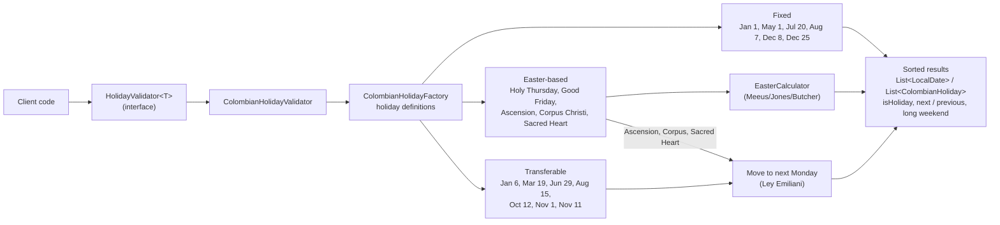

# Colombian Holiday Toolkit

[](https://github.com/AZapata27/colombian-holidays-toolkit/actions/workflows/ci.yml)

## Overview

Colombian Holiday Toolkit is a Java library designed to simplify working with Colombian public holidays. Whether you're building HR software, scheduling applications, or any system that needs to account for Colombian holidays, this toolkit provides easy-to-use methods for various holiday-related operations.

## Features

- Verify if a given date is a Colombian holiday
- Find the next upcoming holiday from a given date
- Count holidays in a specific month or year
- Get a list of all holidays for a given year
- Provide descriptions for each holiday

## Architecture

`ColombianHolidayValidator` implements the generic `HolidayValidator<T>` API. It loads the holiday
definitions from `ColombianHolidayFactory` and resolves the actual dates for a year: fixed holidays
keep their date, Easter-based ones are offset from the Easter Sunday given by `EasterCalculator`,
and transferable ones are moved to the following Monday (Law 51 of 1983, "Ley Emiliani").



## Installation

Add the following dependency to your `pom.xml`:

```xml
<dependency>
    <groupId>io.github.azapata27</groupId>
    <artifactId>colombian-holiday-toolkit</artifactId>
    <version>1.0.0</version>
</dependency>
```
