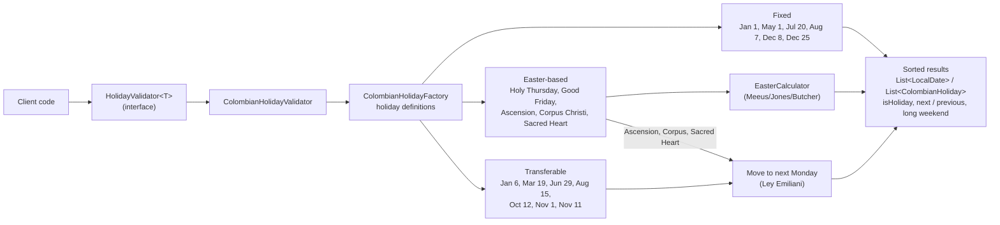

# Colombian Holiday Toolkit

[](https://github.com/AZapata27/colombian-holidays-toolkit/actions/workflows/ci.yml)
[](https://scorecard.dev/viewer/?uri=github.com/AZapata27/colombian-holidays-toolkit)

## Overview

Colombian Holiday Toolkit is a Java library designed to simplify working with Colombian public holidays. Whether you're building HR software, scheduling applications, or any system that needs to account for Colombian holidays, this toolkit provides easy-to-use methods for various holiday-related operations.

## Features

- Verify if a given date is a Colombian holiday
- Find the next upcoming holiday from a given date
- Count holidays in a specific month or year
- Get a list of all holidays for a given year
- Provide descriptions for each holiday

## Architecture

`ColombianHolidayValidator` implements the generic `HolidayValidator<T>` API. It loads the holiday
definitions from `ColombianHolidayFactory` and resolves the actual dates for a year: fixed holidays
keep their date, Easter-based ones are offset from the Easter Sunday given by `EasterCalculator`,
and transferable ones are moved to the following Monday (Law 51 of 1983, "Ley Emiliani").



## Installation

Coordinates: `io.github.azapata27:colombian-holiday-toolkit`. Releases are published to Maven
Central once the publishing credentials are configured (see [Releasing](#releasing)); until then,
download the jars attached to the [GitHub Releases](https://github.com/AZapata27/colombian-holidays-toolkit/releases)
or run `./gradlew publishToMavenLocal`.

<!-- x-release-please-start-version -->

Gradle (Kotlin DSL, `build.gradle.kts`):

```kotlin
dependencies {
    implementation("io.github.azapata27:colombian-holiday-toolkit:0.1.0")
}
```

Gradle (Groovy DSL, `build.gradle`):

```groovy
dependencies {
    implementation 'io.github.azapata27:colombian-holiday-toolkit:0.1.0'
}
```

Maven (`pom.xml`):

```xml
<dependency>
    <groupId>io.github.azapata27</groupId>
    <artifactId>colombian-holiday-toolkit</artifactId>
    <version>0.1.0</version>
</dependency>
```

<!-- x-release-please-end -->

Requires Java 21 or newer.

## Releasing

Versions follow [Semantic Versioning](https://semver.org/) and are derived from
[Conventional Commits](https://www.conventionalcommits.org/) by
[release-please](https://github.com/googleapis/release-please) (`.github/workflows/release.yml`).
`master` only accepts squash merges, so the **pull request title** becomes the commit message and
must follow the convention (`feat: ...`, `fix: ...`, `feat!: ...` / `BREAKING CHANGE:`).

1. Every push to `master` opens or updates a release PR that bumps `version.txt` (read by
   `build.gradle`), `CHANGELOG.md` and the versions in this README. While the version is `0.x`,
   breaking changes bump the minor version.
2. Merging the release PR creates the `vX.Y.Z` tag and the GitHub Release, and attaches the main,
   sources and javadoc jars with a build provenance attestation
   (`gh attestation verify <jar> --repo AZapata27/colombian-holidays-toolkit`).
3. If the four Maven Central secrets exist, the same run signs and publishes the release to Maven
   Central (`publishAndReleaseToMavenCentral`). Without them the step is skipped with a notice.

### One-time setup for Maven Central

1. Create an account at the [Sonatype Central Portal](https://central.sonatype.com/) (sign in with
   GitHub).
2. Verify the namespace `io.github.azapata27`: in **Namespaces** add it, then create the public
   GitHub repository with the verification key the portal shows (e.g. `github.com/AZapata27/<key>`),
   click **Verify** and delete that repository afterwards.
3. Generate a user token (**View Account → Generate User Token**); it gives a username and a password.
4. Create a GPG key and publish its public part:

   ```bash
   gpg --full-generate-key                       # RSA 4096 (or ed25519), with a passphrase
   gpg --list-secret-keys --keyid-format=long    # note the key id
   gpg --keyserver keyserver.ubuntu.com --send-keys <KEY_ID>
   gpg --armor --export-secret-keys <KEY_ID>     # value for SIGNING_KEY
   ```

5. Add the repository secrets (**Settings → Secrets and variables → Actions**):

   | Secret | Value |
   |---|---|
   | `MAVEN_CENTRAL_USERNAME` | user token username |
   | `MAVEN_CENTRAL_PASSWORD` | user token password |
   | `SIGNING_KEY` | ASCII-armored private key (full block, including the BEGIN/END lines) |
   | `SIGNING_PASSWORD` | passphrase of the GPG key |

   Optional: `RELEASE_PLEASE_TOKEN` (fine-grained PAT or GitHub App token with contents, issues and
   pull requests write) so the release PR triggers CI. With the default `GITHUB_TOKEN` the release
   PR does not run the required checks; close and reopen it (or push to its branch) to trigger them.

To publish a release that already exists (secrets added after the tag), check out the tag and run
`./gradlew publishAndReleaseToMavenCentral` locally with the same values as Gradle properties
(`mavenCentralUsername`, `mavenCentralPassword`, `signingInMemoryKey`, `signingInMemoryKeyPassword`).
